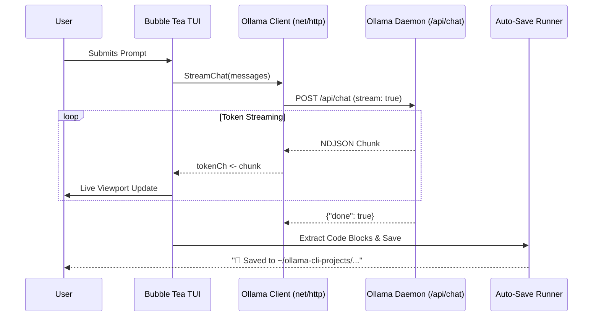

Ollama CLI is designed as a lightweight, single-binary Go application with no heavy Cgo or external C runtime dependencies.

## Directory Structure

```text
ollama-cli/
├── main.go                     # Application entry point
├── cmd/
│   ├── root.go                 # Cobra root command & Viper configuration
│   └── chat.go                 # Chat subcommand that initializes TUI
├── internal/
│   ├── ollama/
│   │   └── client.go           # High-performance HTTP client for /api/chat streaming
│   ├── tui/
│   │   ├── app.go              # Bubble Tea model, view rendering, and state machine
│   │   └── styles.go           # Lipgloss styling, color themes, and ASCII cards
│   └── tools/
│       ├── runner.go           # Execution runner, auto-save, and launch inference
│       ├── runner_windows.go   # Windows subprocess management with CREATE_NO_WINDOW
│       └── runner_other.go     # Unix/macOS process management
├── docs/                       # Mintlify documentation site
├── go.mod
└── README.md
```

---

## Technical Stack

- **[Cobra](https://github.com/spf13/cobra)** — CLI command parsing, flag binding, and help screens.
- **[Viper](https://github.com/spf13/viper)** — Configuration loading from flags, YAML, and environment variables.
- **[Bubble Tea](https://github.com/charmbracelet/bubbletea)** — The Elm-architecture TUI runtime loop.
- **[Lipgloss](https://github.com/charmbracelet/lipgloss)** — Declarative terminal layout and style definitions.
- **[Glamour](https://github.com/charmbracelet/glamour)** — Rich stylesheet-based Markdown rendering in ANSI.
- **[Bubbles](https://github.com/charmbracelet/bubbles)** — Interactive components (textarea, viewport, spinner).

---

## The Streaming Loop



---

## Windows Process Isolation

Running subprocesses inside a full-screen terminal UI can cause screen tearing or steal keyboard focus. Ollama CLI includes OS-specific execution handling in `internal/tools/runner_windows.go`:

- Commands are executed via `cmd.exe /C` to properly handle chaining (`&&`, `||`, pipes).
- Flags like `CREATE_NO_WINDOW` ensure external processes don't flicker background windows.
- Stdin/Stdout/Stderr streams are safely captured and piped back into the Bubble Tea event loop.
